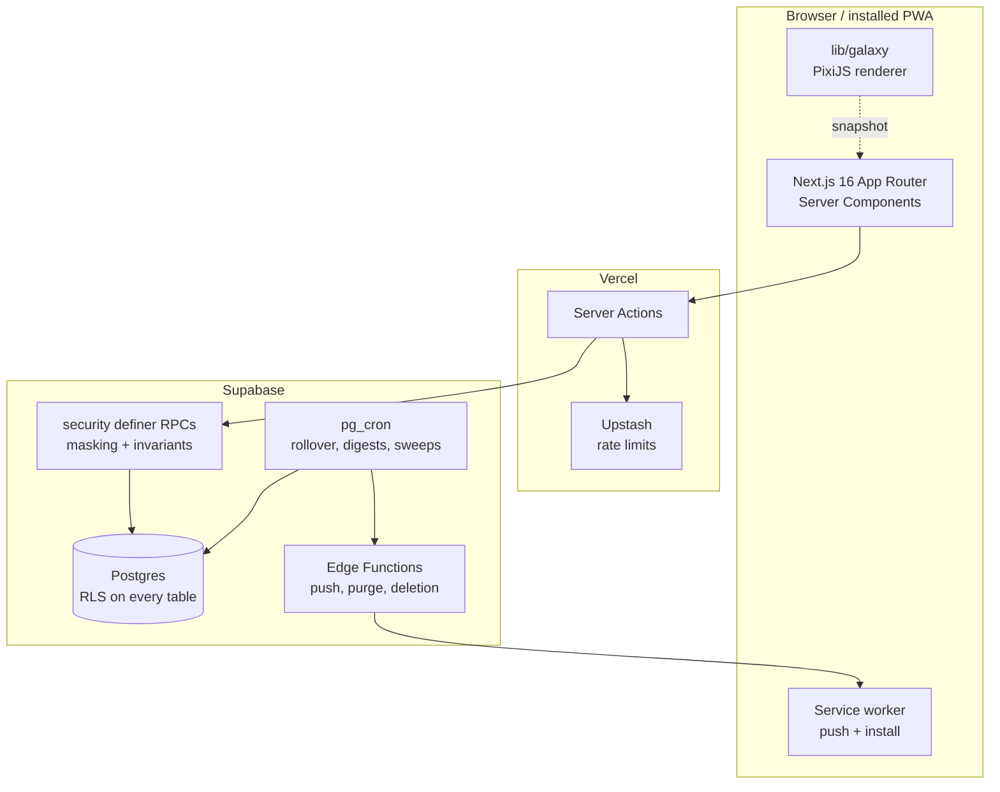

<div align="center">


# Solarity

**Friends in small Circles see each other finish what they set out to do.**

A daily check-in app built around one idea: you keep a goal more reliably when
a handful of people you actually know can see whether you did.


</div>

---

## What it does

| | |
|---|---|
| **One goal, most days** | Onboarding ends when you have a single goal. Everything else fills in behind it. |
| **Circles of up to ten** | Invite-only, by username. Small enough that being seen actually means something. |
| **A day that closes** | Your day rolls over at midnight in *your* timezone, not the server's. |
| **Streaks that are shared** | A Circle keeps a streak together, and decides as a group what happens when it breaks. |
| **Notes and photos** | Optional, per check-in, and you choose per Circle who sees them. |
| **A living sky** | Every member is a sun, every goal a planet. The galaxy is real WebGL, drawn from your actual data. |
| **Digests, not a feed** | Five days at a glance. No infinite scroll, nothing to refresh. |
| **Push that respects you** | Four separate switches, and a notification never names your goal. |

## How it fits together



**The rule that shapes everything:** the database is the boundary, not the app.
Every table has row level security, and anything a reader should not see is
masked inside a `security definer` RPC rather than filtered in TypeScript. A
bug in a component can render the wrong thing; it cannot leak the wrong thing.

## Stack

**Next.js 16** (App Router, Server Actions) · **React 19** · **TypeScript**
strict · **Tailwind 4** over a hand written design system · **Supabase**
(Postgres, RLS, Storage, Edge Functions, pg_cron) · **PixiJS 8** ·
**Upstash Redis** · **Playwright** · **Vitest**

## Quickstart

```bash
git clone https://github.com/<you>/solarity.git
cd solarity
npm install

cp .env.example .env.local   # then fill it in
npm run dev
```

You will need a Supabase project with the migrations in `supabase/migrations/`
applied, and an Upstash Redis instance. `.env.example` lists every variable and
says what each one is for.

**`/admin` does not exist until you make the first administrator by hand.**
Nothing in the app can create one, because there is nobody to authorise it. The
SQL is in [`docs/build-plan.md`](docs/build-plan.md).

## Verifying a change

Cheapest first. Each of these catches something none of the others can.

```bash
npm run typecheck            # next typegen && tsc, not bare tsc
npx eslint .
npm run test:run             # Vitest
npm run build                # the only check that sees the server/client boundary
npx playwright test --list   # compiles every spec without running one
npm run test:e2e             # 25 specs against a real Supabase project
```

```bash
node scripts/design-audit.mjs             # undefined ds-* classes, unresolved CSS vars
node scripts/mock-diff.mjs ../solarity-ui # screens that drifted from their mocks
node scripts/graph-freshness.mjs          # graphify-out vs the repo
```

`E2E_PROD=1 npm run test:e2e:ios` before any deploy. It is the only run that
sees the CSP that actually ships, and both CSP bugs so far were production only
*and* WebKit only.

## Layout

```
app/                 routes, server actions, the design system CSS
  (app)/             signed in, wrapped in chrome and gated
  auth/ onboarding/  signed out and part way in
components/          ui primitives, marks, the galaxy host
lib/                 supabase clients, domain logic, lib/galaxy
supabase/
  migrations/        113 of them, each one argued for in its header
  functions/         Edge Functions
e2e/                 25 Playwright specs and their fixtures
scripts/             standing checks, not build steps
docs/                see below
```

## Design system

Around fifty `ds-*` tokens in `app/design-system.css`, deliberately plain CSS
rather than Tailwind utilities: Tailwind's production purge is the one thing
that can differ between `next dev` and `next build`, and a design system is a
bad place to discover that.

The type scale is five roles, all in `rem`. There is **no** `ds-type-body`, on
purpose: `.ds-app` sets 14px as the inherited base, so a body token would be a
second name for doing nothing.

Read [`docs/design-system.md`](docs/design-system.md) before writing markup. It
is short, and every rule in it cost something to learn.

## Documentation

This repository keeps its reasoning. Most bugs here were found by re-reading an
old "why", so the docs are written to be read rather than skimmed.

| Read | When |
|---|---|
| [`docs/README.md`](docs/README.md) | The index |
| [`docs/build-plan.md`](docs/build-plan.md) | Open work only, and what was decided rather than deferred |
| [`docs/v1/`](docs/v1/README.md) | What shipped in v1 and what it cost |
| [`docs/architecture/`](docs/architecture/README.md) | Schema, security, time and streaks, app structure |
| [`docs/patterns.md`](docs/patterns.md) | Fifty one shapes this codebase keeps producing |
| [`docs/testing.md`](docs/testing.md) | How to run it, and the test traps already met |
| [`docs/history.md`](docs/history.md) | Append only. Why a past decision went the way it did |

## Status

**v1 is complete.** A person can sign up, pick a username and a sun, leave
onboarding with a goal, check it off with a note and a photo, invite a friend by
name, see who finished today, hear about it while the day is still going, keep a
streak, read a digest, retire a goal, report and block, and delete the account
and everything in it. Both galaxies draw on a phone at 17ms a frame with a
hundred planets.

**It is not open to strangers.** There is no legal entity behind it yet, and the
questions that blocks are listed in [`docs/build-plan.md`](docs/build-plan.md)
rather than hand waved. A private beta with people you know is fine.

<div align="center">
<br>
<sub>Built in the open, with the reasoning left in.</sub>
</div>
